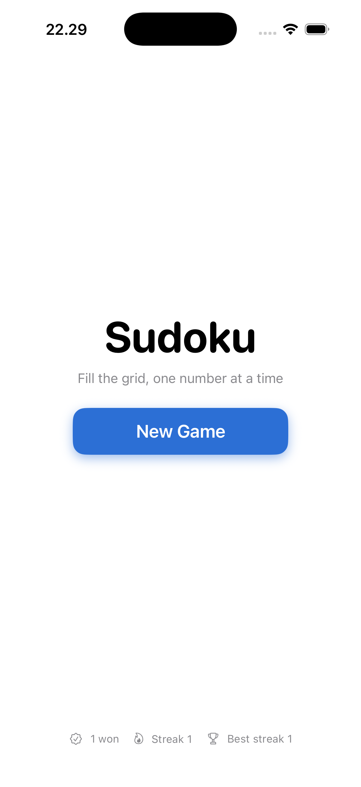

# Sudoku

A polished, fully native **Sudoku game for iOS**, built from scratch in **SwiftUI** with a clean MVVM architecture. Includes a puzzle generator that guarantees unique solutions, an efficient backtracking solver, a logic-based hint system, and the quality-of-life features you'd expect from a shipping app — pencil marks, undo, lives, persistence, haptics, and stats.

<p align="center">
  
</p>

## Features

- **Unique-solution puzzle generator** across three difficulties (Easy / Medium / Hard), each with a different clue count and hint allowance.
- **Logic-based hints** — instead of revealing a fixed cell, the hint engine finds the *next logically solvable* cell (a "naked single" where only one value can go), so hints teach rather than just fill.
- **Three lives** — wrong entries cost a heart; three mistakes ends the run. Wrong guesses show red and auto-clear on your next correct move.
- **Pencil marks (notes)** with a larger, legible layout and automatic candidate elimination.
- **Undo** any move, note, erase, or hint (without refunding hearts or hints — no cheating the limit).
- **Timer + full persistence** — the game auto-saves on exit *and* when backgrounded, so you can resume exactly where you left off, even after force-quitting.
- **Stats** — best time per difficulty, total wins, and win streaks, all persisted locally.
- **Feedback & polish** — haptics on entry / error / win, same-number highlighting, a blurred board while paused, and portrait lock.

## Architecture

The app follows **MVVM** with a strict separation between pure game logic and the SwiftUI view layer — the entire model/logic layer has **zero UIKit/SwiftUI dependencies** (except a thin haptics wrapper), which keeps it fast to reason about and trivial to unit-test.

```
Sudoku/
├── Models/          Value types: Board, Cell, GameState, Difficulty
├── Services/        Pure logic: solver, generator, persistence, stats, haptics
├── ViewModels/      GameViewModel — the single source of truth (@MainActor, ObservableObject)
└── Views/           SwiftUI: menu, board, cells, number pad, timer
```

### Notable engineering

- **Solver** — recursive backtracking enhanced with the **Minimum Remaining Values (MRV)** heuristic and **bitmask candidate tracking**, so it always expands the most-constrained cell first. This makes both solving and the uniqueness check dramatically faster than a naïve left-to-right scan.
- **Generator** — builds a full solution from independent diagonal boxes, then removes cells one at a time, re-running a **2-solution-limited counter** to guarantee the puzzle stays uniquely solvable. Bounded by a deadline so generation can never hang — worst case it yields a slightly easier (but always valid) puzzle instead of spinning.
- **Correctness by construction** — the win check compares the board against the stored solution rather than trusting a "no duplicates" heuristic, so the game can never be won with a wrong cell on the board.
- **Concurrency** — puzzle generation runs on a detached background task and hands the result back to the `@MainActor` view model, keeping the UI responsive during generation.

## Tech

| | |
|---|---|
| Language | Swift 5 |
| UI | SwiftUI |
| Architecture | MVVM |
| Min. iOS | 16.0 |
| Persistence | `UserDefaults` + `Codable` |
| Testing | XCTest |
| Dependencies | None |

## Testing

Unit tests cover the solver (valid completion + rejection of unsolvable boards), the generator (unique solution across all difficulties), and the view-model game logic (pencil marks, hints).

```bash
xcodebuild test \
  -project Sudoku.xcodeproj \
  -scheme Sudoku \
  -sdk iphonesimulator \
  -destination 'platform=iOS Simulator,name=iPhone 15'
```

## Getting started

1. Open `Sudoku.xcodeproj` in Xcode 15+.
2. Select an iOS Simulator (or a device).
3. Build & run (`⌘R`).
